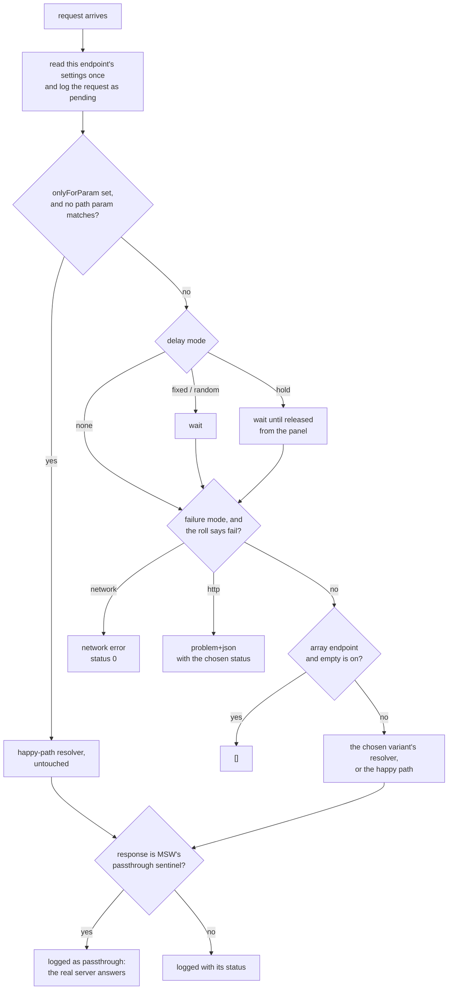

# mock-control

Runtime-configurable [MSW](https://mswjs.io) mocks for Angular apps, and a panel to
change them while the app runs: slow an endpoint down, fail it, empty it, hold a request
until you let it go, or swap in a different response. Settings survive a reload.

Built so a room can watch a page misbehave on purpose: what does this screen do
when the reviews service takes three seconds? When the holds request fails? When two
responses arrive out of order?

Published as `@hypertheory-labs/mock-control`. **Angular only.**

## Requirements

- Angular 22, with MSW 2.
- **Tailwind CSS v4 and daisyUI 5 in the app.** The panel uses their classes and ships no
  styles of its own. This is a stopgap; see step 5 below.

## Setup

### 1. Install

```sh
npm install -D @hypertheory-labs/mock-control msw
npx msw init public --save
```

`msw init` copies `mockServiceWorker.js` into `public/`, so it's served from the root.
In a multi-project workspace, use that project's `public/` directory.

### 2. Write the handlers

```ts
// src/mocks/handlers.ts
import { HttpResponse } from 'msw';
import { configurable } from '@hypertheory-labs/mock-control';

export const handlers = [
  configurable(
    { id: 'catalog.title', label: 'Catalog: title', method: 'GET', path: `${catalog}/titles/:id` },
    ({ params }) => HttpResponse.json(findTitle(params['id'])),
  ),
];
```

See [Using it](#using-it) for variants, array endpoints, and pass-through.

### 3. Create the worker

```ts
// src/mocks/browser.ts
import { setupWorker } from 'msw/browser';
import { mockStore } from '@hypertheory-labs/mock-control';
import { handlers } from './handlers';

export const worker = setupWorker(...handlers);

// ?mock=flaky (or any preset name) applies that scenario on load, so you can hand out a link.
const preset = new URLSearchParams(location.search).get('mock');
if (preset) mockStore.applyPreset(preset);
```

### 4. Start it before bootstrapping, in development only

```ts
// src/main.ts
import { bootstrapApplication } from '@angular/platform-browser';
import { isDevMode } from '@angular/core';
import { appConfig } from './app/app.config';
import { App } from './app/app';

async function startMocks() {
  if (!isDevMode()) return;
  const { worker } = await import('./mocks/browser');
  await worker.start({ quiet: true, onUnhandledRequest: 'bypass' });
}

await startMocks();
bootstrapApplication(App, appConfig).catch((err) => console.error(err));
```

`onUnhandledRequest: 'bypass'` lets anything without a handler go to the network.

### 5. Add the panel, deferred

```ts
// src/app/app.ts
import { Component, isDevMode } from '@angular/core';
import { MockPanel } from '@hypertheory-labs/mock-control';

@Component({
  selector: 'app-root',
  imports: [MockPanel],
  template: `
    <!-- ...the app... -->
    @if (isDev) {
      @defer (on idle) {
        <mock-panel />
      }
    }
  `,
})
export class App {
  protected readonly isDev = isDevMode();
}
```

Then tell Tailwind to look inside the package for the panel's classes. Tailwind skips
`node_modules` unless it's told otherwise:

```css
/* src/styles.css */
@import 'tailwindcss';
@source '../node_modules/@hypertheory-labs/mock-control';
@plugin 'daisyui';
```

### Keeping it out of production

Both entry points are dynamic imports behind `isDevMode()`: the `import()` in `main.ts`,
and the `@defer` block, which Angular turns into one. In a production build, the panel,
the store, your handlers, and MSW land only in lazy chunks, and nothing loads them.
**Measured** on an Angular 22 production build: none of the initial chunks reference them.

**They are still emitted and deployed**, and so is `public/mockServiceWorker.js`. "Never
loaded" isn't the same as "not shipped."

**One static import undoes this.** Importing `./mocks/browser` (or anything from it)
anywhere outside those two places pulls it into the initial bundle. So does using
`<mock-panel />` outside a `@defer` block.

### Leaving it out of the build entirely

If you don't want the chunks deployed at all, swap the dev tools for a stub in
production builds. Put everything dev-only in one file:

```ts
// src/dev-tools.ts
import { Component } from '@angular/core';
import { MockPanel } from '@hypertheory-labs/mock-control';

export async function startMocks() {
  const { worker } = await import('./mocks/browser');
  await worker.start({ quiet: true, onUnhandledRequest: 'bypass' });
}

@Component({ selector: 'app-dev-tools', imports: [MockPanel], template: `<mock-panel />` })
export class DevTools {}
```

and a stub with the same exports:

```ts
// src/dev-tools.prod.ts
import { Component } from '@angular/core';

export async function startMocks() {}

@Component({ selector: 'app-dev-tools', template: `` })
export class DevTools {}
```

`main.ts` calls `await startMocks()` with no `isDevMode()` check, and the app template
uses `<app-dev-tools />` with no `@if` or `@defer`. Then, in `angular.json`, under the
production configuration:

```json
"fileReplacements": [
  { "replace": "src/dev-tools.ts", "with": "src/dev-tools.prod.ts" }
],
"assets": [
  { "glob": "**/*", "input": "public", "ignore": ["mockServiceWorker.js"] }
]
```

**Measured** on an Angular 22 production build: nothing from mock-control, your handlers,
or MSW is in the output, and neither is the worker file. A development build still has
all of it.

**The stub is only type-checked in production builds.** If `dev-tools.ts` gains an export
the stub doesn't have, `ng serve` is fine and `ng build` fails.

## What `configurable()` does with a request

The resolver you write is the happy path. Everything else is applied around it, in
this order:



Settings are read once, at the start, so changing them mid-request doesn't affect a
request already in flight.

## Using it

### A mocked endpoint

- **`id`** is the key settings are saved under. Keep it stable.
- **`returnsArray: true`** offers "return an empty array" in the panel.
- A third argument, **`variants`**, offers named alternative responses:

```ts
configurable(
  {
    id: 'api.branches',
    label: 'Branches',
    method: 'GET',
    path: `${api}/branches`,
    returnsArray: true,
  },
  () => passthrough(),
  { thousand: { label: '1,000 branches', resolve: () => HttpResponse.json(manyBranches) } },
);
```

### A real endpoint, still controllable

Return MSW's `passthrough()` from the resolver, and the real server answers, but the
panel can still delay or fail the request first. The log shows it as `passthrough`
(not the 302 sentinel MSW uses internally), with no duration, since the time is the
real server's.

**Mocks are for things you only read; things that remember are a real API.** An
endpoint whose data the app changes gets a pass-through entry, not a mock.

## The panel

| Setting           | Effect                                                                                       |
| ----------------- | -------------------------------------------------------------------------------------------- |
| Response          | The default, or a named variant                                                              |
| Delay             | None, fixed, random (min–max: responses arrive out of order), or **hold** (released by hand) |
| Failure           | HTTP (a status, as problem+json) or network (status 0), at a rate from 0–100%                |
| Empty array       | Array endpoints return `[]`                                                                  |
| Only when param = | Apply the settings only when a path param equals this value (e.g. only title `1001`)         |

**Presets** set every endpoint at once and keep each one's chosen variant: Happy
path, Slow network (2 s), Out of order (200–3000 ms), Flaky (30% 503s), Server down
(500s), Offline (network errors), Empty lists.

The **request log** shows the last 100 requests: endpoint, variant, status, duration,
outcome. Held requests can be released from it.

## Where settings live

`localStorage['mock-control:v1']`: `{ configs, activePreset }`. Per browser, per
origin. A saved variant that no longer exists falls back to the default. To reset
from a test or a console: remove the key and reload.

## Known limits (measured, msw 2.15, Chrome)

- **MSW never sees a client abort.** When Angular cancels a request, the page's fetch
  rejects, but the mock's request signal never fires. So the panel can't show
  cancellation, and a held request whose client gave up stays "held." The `aborted`
  outcome exists in the code and, as far as we've seen, never happens. Showing
  cancellation needs a real API.
- **MSW stops mocking in a long-hidden tab.** The worker loses its client list when
  Chrome stops it, and everything goes to the real network ("Failed to fetch" for
  the made-up origins). Reload the tab.

## Not yet

- **Scenarios scoped to a route** ("this page's reviews are slow"): today settings
  are per endpoint, app-wide.
- **Macros**: a named sequence of settings for a lab step ("make holds fail, then
  recover").

## For contributors

`src/lib/core/` never imports Angular. MSW handlers run in the page, outside Angular's
injector (the service worker only forwards requests), so `configurable()` reads the
store directly. `src/lib/panel/` wraps the same store in signals (`MockControl`). This
is a rule about the code, not a promise to users: the package is Angular only.
